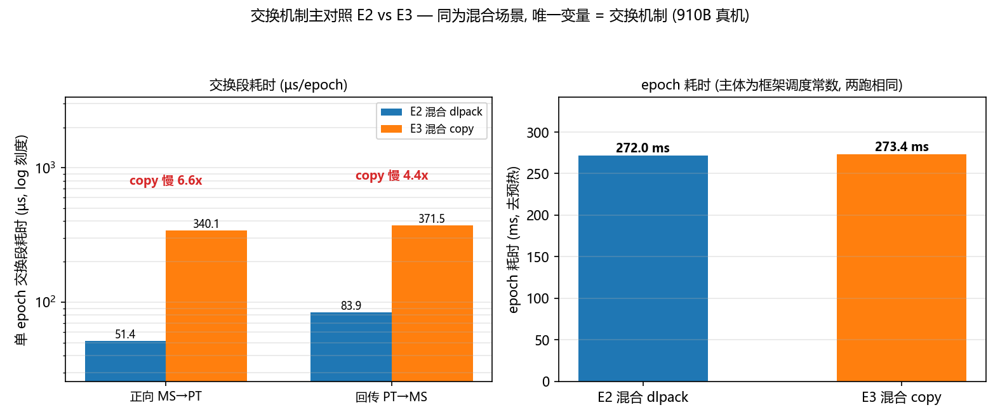
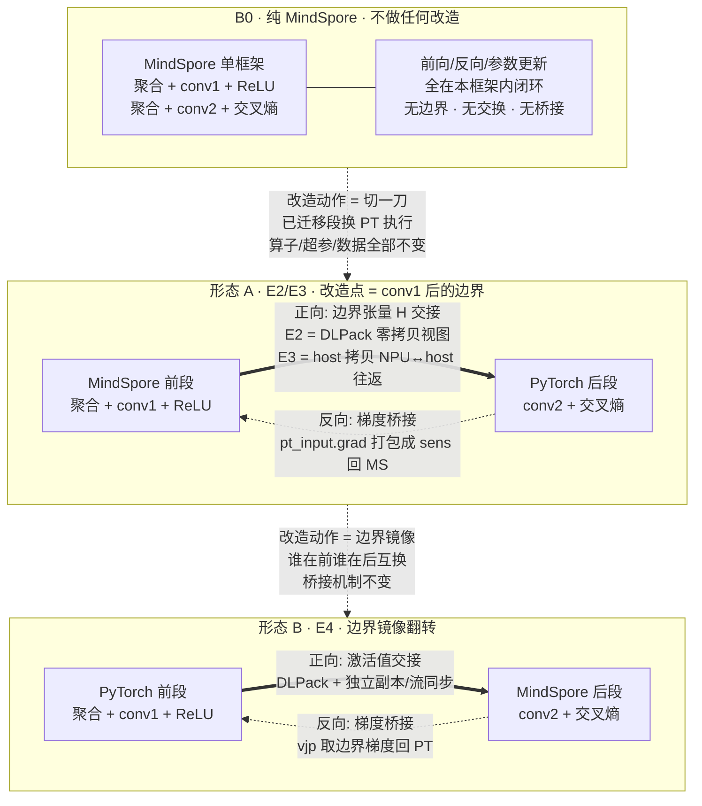
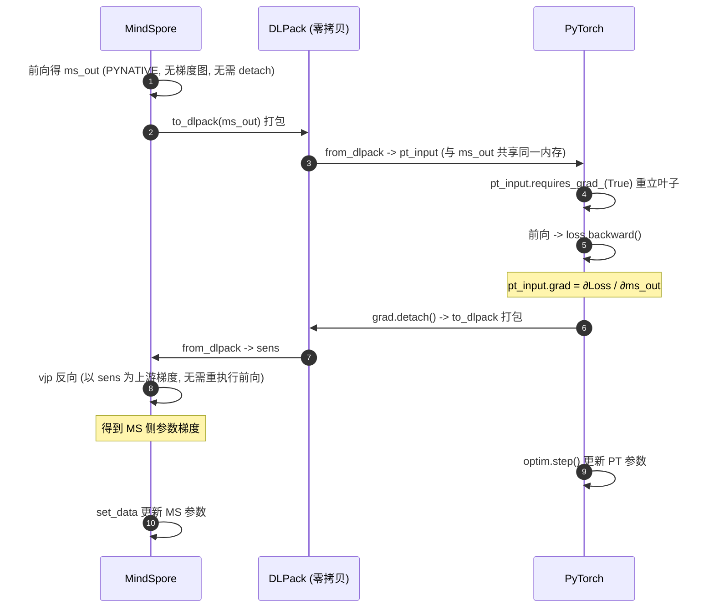

# DLPack 混合训练实践报告：MindSpore → PyTorch 渐进迁移的过渡态

## 结论速览

本报告用一组真机对照实验回答两件事：**DLPack 混合过渡态是否有收益且敢切换**（前两问，§3.2~§3.7），以及**这套改动能否照搬到你的模型**（够通用吗，§4）。

| 主线问题 | 结论 | 关键实测 |
|---|---|---|
| **敢切吗**（切换等价性） | ✅ 混合态 ≡ 纯 MindSpore | test Accuracy 80.3% vs 80.3%（差 0.00pt），final loss 比 1.003 |
| **选对了吗**（交换机制） | ✅ 边界交换选 DLPack 零拷贝 | 训练内交换段比 host 拷贝快：正向 6.6×、回传 4.4×；独立 bench 正向随尺寸升至 60.9× |
| **够通用吗**（方案通用性） | ✅ 设计通用 | 边界协议零改动、判据可复用（G1）；镜像形态 B 等价性全过；模型无关性待首个真实模型实证（§7） |

机制正确性 17/17 检查项通过（零拷贝语义 / 桥接解析解 / 负对照 / 图语义聚合 / 稀疏完整性）。昇腾 910B / Atlas A2 真机实测，seed=42，结果可复现（§6）。**适合谁**：规划跨框架渐进迁移的工程团队、需要跨框架共享张量的开发者、要设计混合训练验收判据的架构与测试同学；**能带走**：三问验收框架与判据模板、模型无关的交换原语与单步训练循环（可直接抄，§4）、910B 实测数字与 7 条踩坑速记（§5）。

## 1 背景：为什么需要混合过渡态

业界训练框架以 PyTorch 为主，基于 MindSpore 实现的存量模型普遍存在渐进迁移的诉求；真正的难点不在"能不能重写"，而在**迁移周期与模型演进并行**——人力只够逐模块迁移，训练迭代却不能停。通往同一终点的路线不止一条（设计论证，非基准测试）：**整体重写、一次切换**要求长时间停训或双轨维护两套代码；**ONNX 等中间表示转换**静态化与自定义算子支持有限，切换是整体替换而非逐模块共存；**逐模块共存（本文路线）**让两侧各自原生执行、边界只交换张量，前提是有一条廉价的跨框架张量通道。DLPack 正是这条通道：零拷贝、PyTorch 与 MindSpore 双方原生支持、不引入第三方转换层。

过渡态下，模型在选定切分点被分成两段：一段用 PyTorch、另一段留 MindSpore，边界做零拷贝张量交换 + 梯度桥接，两侧参数在**同一步训练中联合更新**。切分只有两种形态——**形态 A：MS 前段 + PT 后段**，**形态 B：PT 前段 + MS 后段**，二者互为镜像。这个方案成立需要回答三个问题，构成全文主线：

1. **敢切吗（切换等价性）**：混合态相对纯 MindSpore 现状，收敛与精度是否一致？
2. **选对了吗（交换机制）**：边界交换用 DLPack 零拷贝，还是 host 拷贝？
3. **够通用吗（方案通用性）**：这套改动是否模型无关——换一个行业模型能否照着 §4 快速改造？桥接是否不依赖切分方向（A、B 镜像验证）？

## 2 验证设计：三个问题，两种形态

**编号速查**（全文沿用）：B0 = 纯 MindSpore 参照臂（唯一基线，每次运行同种子同初始化同跑）；E1 = 机制验证（17 检查项）；E2 = 混合训练 · 形态 A · DLPack 交换（主结果）；E3 = 与 E2 唯一变量 = 交换机制（host 拷贝对照）；E4 = 混合训练 · 形态 B（对称形态）；E5 = 纯交换吞吐 bench；C1~C4 = 正确性判据；G1 = 方案通用性（设计判据）；P1/P2 = 性能参考项（不作判据，GCN 数字仅参考样本，§3.7）。

**验证载体**是真实开源模型 **GCN on Cora**（Kipf & Welling 两层图卷积 + PyG Planetoid，2708 节点/1433 维特征/7 分类）——挑一个图网络代表模型做例子，不代表迁移对象本身是 GCN。选它因为自带真实的图语义算子（scatter 聚合/gather），超参用 Kipf 论文原始 recipe（Adam lr=0.01、weight_decay=5e-4、200 epochs 全批）公开可复核，且规模小到单卡快速迭代；**方法、判据与公共改造点面向任意 MindSpore 模型**（§4.4）。

**对照设计**：每次运行 B0 与混合臂同种子、同初始化、同数据、同超参一起训练——回答"敢切"（B0 之外不做纯 PyTorch 臂：那是迁移终点后的实现工作，不在过渡态验证范围）；E2 vs E3 唯一变量 = 交换机制，两跑框架调度开销完全相同，差值纯粹来自交换机制——回答"选对"；E4 = 形态 B 镜像验证，证明桥接与切分方向无关；E5 与模型解耦，给机制级收益上界。

**判据体系**两类，全部以 B0 为锚：**C = 机制正确性，必须全过；G = 方案通用性**（设计层面）。性能与实际模型强相关，不作本阶段判据，仅作参考项披露（GCN 数字仅参考样本，判定口径见 §3.7）：

| 编号 | 判据 | 口径 |
|---|---|---|
| C1 | 图语义聚合一致 | 交换边界两侧各做一次 scatter 聚合，结果一致 ≤1e-5（必过） |
| C2 | 梯度等价性（双锚） | 桥接梯度 vs torch 参考锚 + vs B0 纯 MS 端到端锚，相对误差 < 5e-3 |
| C3 | 稀疏参数完整性 | 交换路径上未访问 Embedding 行梯度恒零、更新后零变化 |
| C4 | 收敛曲线一致性 | 逐位一致不可达（归约顺序噪声），口径 = ulp 级差 ≤1e-5 + Accuracy 趋势重合；混合 vs B0 统计等价（loss 比 ∈[0.5, 2.0]、Accuracy 差 ≤1.5pt） |
| G1 | 方案通用性（设计判据） | 公共部分与模型解耦：交换原语/单步循环/双锚/判据不随模型变化（§4）；镜像形态 E4 等价性全过（§3.4）；接入新模型按 §7 清单复核 |

## 3 验证结果

### 3.1 一屏总览

| 判据 / 问题 | 结果 | 关键实测 |
|---|---|---|
| E1 机制验证（17 检查项） | ✅ | 17/17 PASS |
| C1 图语义聚合一致 | ✅ | 相对误差 0.0（≤1e-5） |
| C2 梯度等价性（双锚） | ✅ | torch 锚 ≤9.1e-05 / B0 锚 ≤9.1e-05（容差 5e-3） |
| C3 稀疏参数完整性 | ✅ | 未访问行梯度恒零，更新后零变化 |
| C4 收敛曲线一致性 | ✅ | E2/E3 final loss 差 9.3e-10（ulp 级）；三臂收敛于 80.3% |
| G1 方案通用性 | ✅ | 边界协议零改动，改造点仅 #1/#2 图网络特有（§4.1）；镜像形态 B 全过（§3.4）；待真实模型实证（§7） |

✅ = PASS（判据全部通过）。

### 3.2 敢切：混合训练 ≡ 纯 MindSpore

每次运行 B0 与混合臂同种子同初始化训练 200 epochs，三臂并排：loss 比 1.0030（∈[0.5, 2.0]），test Accuracy 差 **0.00pt**（≤1.5pt）——**切换不改变训练效果**，从纯 MS 切到混合态的第一天，训练曲线就与现状重合。

| 指标 | B0 纯 MindSpore | E2 混合（dlpack） | E3 混合（copy） |
|---|---|---|---|
| final loss | 0.0098 | 0.0099 | 0.0099 |
| test Accuracy | 80.3% | 80.3% | 80.3% |


*图 1 —— 训练 loss 与 test Accuracy 曲线（B0 灰 / E2 蓝 / E3 橙）。*

### 3.3 选对：交换段 DLPack 比 host 拷贝快 6.6×/4.4×

两臂唯一变量是交换机制，归因干净（Cora 全批训练每 epoch 恰一次参数更新，µs/epoch 即单步交换耗时）：

| 指标 | E2 dlpack | E3 host 拷贝 | 判定 |
|---|---|---|---|
| final loss | 0.0099 | 0.0099 | ✅ 一致（差 9.3e-10，恰为 1 个 fp32 ulp） |
| test Accuracy | 80.3% | 80.3% | ✅ 一致（差 0.00pt） |
| 交换段 正向/回传（µs/epoch） | 51.4 / 83.9 | 340.1 / 371.5 | **copy 慢 6.6× / 4.4×** |
| epoch 耗时（去预热） | 272.00 ms | 273.43 ms | ✅ dlpack 快 |

两种机制训练出 **ulp 级一致**的数值——交换机制不影响数值，可放心选型；epoch 绝对差（+1.4 ms）被框架调度常数摊薄，机制级收益上界见 §3.6。



*图 2 —— 交换段耗时（µs/epoch，log 刻度）与 epoch 耗时。*

### 3.4 方向无关：镜像形态 B 同样成立

形态 B 是形态 A 的镜像：PT（聚合+conv1）──dlpack──▶ MS（conv2）。E4 与其运行内 B0 对照：

| 指标 | B0 纯 MindSpore | E4 对称混合 | 判定 |
|---|---|---|---|
| final loss | 0.0098 | 0.0098 | loss 比 1.0000 |
| test Accuracy | 80.3% | 80.3% | 差 0.00pt ✅ |
| C2 双锚 rel_err | — | torch 9.1e-05 / B0 7.3e-05 | ✅ PASS |

**切分方向不影响桥接机制**：E4 的交换是 PT→MS（激活值）与 MS→PT（边界梯度）双向，与 E2 互为镜像，等价性与双锚全过——方向无关是方案通用性的第一半，模型无关的另一半见 §4.4。一个如实披露：E4 epoch 耗时 17 ms 远低于 E2 的 272 ms，不是"E4 更优"，而是两形态框架分工不同（形态 B 把更多计算放到调度更快的 PT 侧）；E4 验证机制对称性，不构成性能对照（对照只有 E2 vs E3）。

### 3.5 机制正确性：E1 证据与梯度双锚

收敛一致也可能是"两边都没训起来"的假象，E1 在训练前先证明桥接的数学正确性：

| 证据项 | 真机实测 |
|---|---|
| 双向零拷贝语义 | 一侧原地修改，另一侧同步可见（PT→MS 共享 NPU 显存 / MS→PT 共享 host 内存） |
| 前向 loss vs float64 解析解 | 0.22105893 vs 0.22105896 |
| 桥接梯度 vs 解析解（pt_input.grad / W₁ / b₁） | 相对误差 ≤1.4e-07（容差 5e-3，低约 5 个数量级） |
| C1 图语义聚合两侧一致 | 相对误差 0.0（≤1e-5） |
| 负对照（假 sens 必须不同） | 梯度差 \|ΔW\| = 1.515 → 传递的是真实上游梯度 |
| C3 稀疏 Embedding 完整性 | 未访问行梯度恒零，更新后零变化 |
| 两侧参数有效更新 / 单次交换 | PT 1.12e-04、MS 4.03e-03 / dlpack 12.1 µs vs copy 31.1 µs |

C2 的落地手段是**双锚**：每个混合臂训练前，同权重单步对照 torch 参考（证明桥接数学正确）与 B0 端到端梯度（证明与基线等价）——

| 运行 | torch 锚 rel_err | B0 锚 rel_err |
|---|---|---|
| E2 / E3 | 1.04e-05 / 2.71e-05 | 9.06e-05 |
| E4 | 9.06e-05 | 7.25e-05 |

全部远小于容差 5e-3。容差说明：1433 维特征经两层传播会放大跨框架 ulp 差，故 B0 锚容差放宽至 max(rtol, 5e-3)——NPU 运行 rtol=5e-3 时两锚同容差，该放宽只在 CPU 冒烟（rtol=1e-3）时生效。


*图 3 —— 判据评分卡：C2 双锚 / C4 机制间一致 / 收益·步时延 / E5 加速比。*

### 3.6 收益上界：正向随尺寸放大至 60.9×

与训练解耦的纯交换吞吐扫描（边界张量 = 节点数 × 16 × 4B，同进程对比）：

| 边界张量 | 正向 MS→PT dlpack / copy | 收益 | 回传 PT→MS dlpack / copy | 收益 |
|---|---|---|---|---|
| 169 KB（2708 节点） | 19.2 / 150.7 µs | **7.8×** | 33.9 / 180.1 µs | **5.3×** |
| 1.0 MB（16384） | 19.0 / 406.1 µs | **21.4×** | 121.6 / 624.5 µs | **5.1×** |
| 4.0 MB（65536） | 19.5 / 1188.1 µs | **60.9×** | 448.5 / 2033.8 µs | **4.5×** |

两个如实的读数：**正向收益随尺寸放大**——DLPack 正向是常数时间的视图创建（三档均 ≈19 µs），copy 是 NPU→host→NPU 线性拷贝，比值随尺寸增长；**回传收益稳定在 4.5~5.3×**——回传方向 DLPack 自身有随尺寸增长的少量开销，比值不放大但保持显著优势。结论比"越大越快"更稳：**任何尺寸下 DLPack 都显著更快，尺寸越大正向优势越大**；真实 GNN 的边界张量通常远大于 4 MB。


*图 4 —— 纯交换吞吐对比（log 刻度）。*

### 3.7 性能参考：以实际模型口径判定，GCN 数据仅供参考

性能与模型规模、框架分工强相关，下表 GCN 数字**仅是参考样本，不构成判定**；接入实际模型时按右列口径重新度量：

| 指标 | GCN on Cora 实测（仅参考） | 实际模型判定口径 |
|---|---|---|
| 交换信噪比 | 正向+回传占单步训练：E2 0.05%、E3 0.26%；E4 8.69%（单步仅 17 ms，且交换前需复制独立副本 + 流同步，这份安全成本计入交换耗时） | 交换耗时 / 真实单 batch 训练耗时（例：交换 100 µs / 单 batch 100 ms = 0.1%），<1% 为佳 |
| 训练总账 | E2/E3 272/273 ms、E4 17 ms（去预热）；B0 ≈0.4 s，同一量级 | 真实模型 ≥3 epoch 总账 ≤B0×1.2 为 PASS（§7 接入清单） |

两个防误读说明：混合臂 272 ms **低于** B0 约 0.4 s，原因不在交换而在框架分工——B0 是 MS PYNATIVE 逐算子下发，小模型全批下调度常数占大头，混合态把约一半算子移到 PT 侧后总开销反而下降，**不能外推**为"混合态一定比纯 MS 快"；E4 的 17 ms 也不构成"E4 更优"（§3.4 已披露，不与 E2 直接对比）。

## 4 可复用方案核心

### 4.1 两种切分形态与五处改造点

GCN 的两层结构是 `H = ReLU(Agg(X)·W1 + b1)`、`logits = Agg(H)·W2 + b2`（Agg = scatter 均值消息传递）。混合改造在 conv1 之后切开，边界张量是节点表示 H（2708×16）——**同一个切分点，两种形态都要跑通**：



**读图方式——改的只有边界**：B0 与混合臂的唯一差异就是图中加粗的边界。形态 A 在 conv1 后把链切成两段，多一次正向交换与一次反向桥接，其余算子、超参、数据完全不变；E2/E3 仅交换实现不同（DLPack 零拷贝 vs host 拷贝），交换函数之外的代码逐行同源——这就是"选对"对照的归因基础。形态 B 只是把边界镜像翻转（谁在前谁在后互换），桥接机制不变。两种形态训练时都是**两侧参数在同一步联合更新**（PT `optim.step()` + MS 侧 Adam `step`），虚线即梯度桥接（§4.3）。围绕切分动了五处——其中 #1、#2 是图网络场景特有，#3~#5 任意模型通用：

| # | 改造点 | 具体做法 | 为什么 / 踩过的坑 |
|---|---|---|---|
| 1 | 聚合算子对齐 | MS `unsorted_segment_sum(gather(X,src),dst)×inv_deg` ↔ PT `zeros.index_add_(0,dst,h[src])×inv_deg`，scatter 均值、$O(E \cdot F)$ | 真实 GNN 的算子语义；不用稠密 $\hat{A} \cdot X$——Cora 稠密版 ≈10.5 GFLOP，会把交换耗时淹没在计算里 |
| 2 | 切分点选 conv1 之后 | 边界张量 = 节点表示 N×16，两种形态共用同一位置 | 真实 GNN 的典型切分位置；一个切分点覆盖双向交换与两种桥接路径 |
| 3 | 优化器严格同源 | PT `torch.optim.Adam` ↔ MS 逐参数同口径 Adam（lr=0.01、wd=5e-4，Kipf recipe） | E4 的 MS 后段最初用裸 SGD，200 epochs 完全不收敛（test Accuracy 14.4% = 随机水平）——**跨框架优化器必须同源**，实战第一大坑 |
| 4 | 多臂参数独立 | B0 / 混合 / 对称各臂的 Parameter 各自独立拷贝 | 曾因对称臂复用参照臂权重，从"训练过的权重"起步造成隐性污染（对照失真） |
| 5 | 双锚标定按拓扑取边界 | 形态 A 取 conv1 边界梯度；形态 B 取 conv1+conv2 全部参数梯度 | 标定的必须是"该形态实际经过桥接的那部分梯度"，锚才算数 |

### 4.2 交换四原语（模型无关）

四个函数与模型无关，换任何模型原样复用；`copy` 分支即 E3 的对照路径（节选自 `scripts/experiments/gcn_hybrid.py`，import 与计时细节有删节）：

```python
def _npu_sync():
    if CFG["is_npu"]:
        torch.npu.synchronize()

def exchange_forward(ms_out):
    """MS -> PT（E2/E3 正向；仅交换段计时）"""
    t0 = time.perf_counter()
    if CFG["exchange"] == "dlpack":
        pt_input = torch_from_dlpack(ms_to_dlpack(ms_out))    # 零拷贝视图
    else:                    # E3 对照: host 拷贝（NPU->host->NPU 往返）
        pt_input = torch.from_numpy(np.array(ms_out.asnumpy()))
        if CFG["is_npu"]:
            pt_input = pt_input.to(CFG["device"])
    return pt_input, time.perf_counter() - t0

def exchange_backward(pt_input):
    """PT 边界梯度 -> MS sens（E2/E3 回传）"""
    t0 = time.perf_counter()
    grad = pt_input.grad.detach()        # 带梯度信息的张量必须先 detach 才能导出
    if CFG["exchange"] == "dlpack":
        sens = ms_from_dlpack(torch_to_dlpack(grad))          # 零拷贝视图
    else:
        sens = ms.Tensor(to_np(grad))
    return sens, time.perf_counter() - t0

def exchange_activation(pt_act):
    """PT -> MS 激活值（E4 正向；NPU 上必须先拷贝 + 同步）"""
    t0 = time.perf_counter()
    _npu_sync()
    h_copy = pt_act.detach().clone()     # dlpack 只是视图: 不拷贝, MS 侧会读到
    h_ms = ms_from_dlpack(torch_to_dlpack(h_copy))            # 被后续计算覆写的数据
    del h_copy
    _npu_sync()                          # 等待写入完成再交棒
    return h_ms, time.perf_counter() - t0

def exchange_grad_ms2pt(g_ms):
    """MS -> PT 边界梯度（E4 回传）"""
    t0 = time.perf_counter()
    _npu_sync()
    g_copy = ms.Tensor(to_np(g_ms))      # 独立副本
    # dlpack 输出可能落在 CPU -> 强制搬回 NPU（E4 首跑崩溃的根因）
    g_pt = torch_from_dlpack(ms_to_dlpack(g_copy)).to(CFG["device"])
    _npu_sync()
    return g_pt, time.perf_counter() - t0
```

### 4.3 单步训练循环（模型无关）

**形态 A**——每步训练一个循环（节选自 `train_mixed`，评估与计时逻辑有删节）。先看懂 `mindspore.vjp(fn, *inputs)`：`fn` 是"该段的普通前向函数"（输入张量与参数作显式入参），返回 `(前向输出, 反向函数)`；反向函数只收上游梯度种子，一次返回 `fn` 全部入参的梯度，**不重执行前向**。`sens` 是 MindSpore 官方对上游梯度的称呼：

```python
opt_ms = MsAdam([w1_ms, b1_ms], args.lr, args.weight_decay)   # MS 侧优化器 (收梯度列表)

ms_out, bwd_fn = vjp(ms_front_fn, x_ms, w1_ms, b1_ms)   # ① MS 前段: 前向 + 反向函数一次拿到
pt_input, _ = exchange_forward(ms_out)                  # ② 边界张量 MS -> PT (零拷贝视图)
pt_input.requires_grad_(True)                           # ③ 重立叶子, 接入 PT 计算图
logits = _pt_head(pt_input, w2_t, b2_t)                 # ④ PT 后段前向 (conv2)
loss = torch.nn.functional.cross_entropy(logits[idx], y_t[idx])
loss.backward()                                         # ⑤ PT 局部反向
sens, _ = exchange_backward(pt_input)                   # ⑥ pt_input.grad 打包回 MS (上游梯度)
_, dw1, db1 = bwd_fn(sens)                              # ⑦ MS 反向: 由 sens 得本侧参数梯度
opt_pt.step(); opt_pt.zero_grad()                       # ⑧ PT 参数更新
opt_ms.step([dw1, db1])                                 # ⑨ MS 参数同一步联合更新
```

**形态 B**——方向镜像，梯度种子改由 MS 侧 vjp 给出（节选自 `train_sym`）：

```python
ms_tail_ce_fn = lambda h, w2, b2: _ms_tail_ce(h, w2, b2, y_ms, idx_ms)
                                                        # MS 后段: 聚合 -> conv2 -> 交叉熵
h_act = torch.relu(_agg_pt(x_t) @ w1_t + b1_t)          # ① PT 前段前向 (保持在计算图内)
h_ms, _ = exchange_activation(h_act)                    # ② 边界张量 PT -> MS (独立副本+流同步)
loss, bwd_fn = vjp(ms_tail_ce_fn, h_ms, w2_ms, b2_ms)   # ③ MS 后段前向 + 反向函数就绪
grads = bwd_fn(ms.Tensor(1.0))                          # ④ 标量种子一次取 (边界梯度, dW2, db2)
g_pt, _ = exchange_grad_ms2pt(grads[0])                 # ⑤ 边界梯度 MS -> PT
h_act.backward(gradient=g_pt)                           # ⑥ 外部梯度种子驱动 PT 前段反传
opt_sym_pt.step()                                       # ⑦ PT 参数更新
opt_sym_pt.zero_grad()
opt_ms_sym.step([grads[1], grads[2]])                   # ⑧ MS 参数同一步联合更新
```

桥接的完整时序（以形态 A 为例）：



要点：两次交换都是同一块内存的视图而非拷贝；PT 侧通过"重立叶子"把外部张量接进本地计算图；MS 侧 vjp 以 `sens` 为上游梯度一次反向。

### 4.4 映射到任意模型：只需替换三样东西

这是三问之三的答案：§4.2/§4.3 的模式与模型解耦，接入任意模型（含真实 GNN）只需替换：

1. **切分点与边界张量**：选一个中间激活值，两侧各留一段——边界张量 = 该激活值；
2. **两侧段函数**：MS 侧封装为传给 `vjp` 的普通前向函数（张量与参数作显式入参，如 `ms_front_fn`），PT 侧就是普通计算图——这是全部的"接入约定"；
3. **两侧优化器**：严格同源同超参（§4.1 改造点 3）。

交换四原语、双锚标定、判据体系（C1~C4/P1~P2）原样复用——边界协议零改动，改造工作量集中在两段各自的前向函数封装上。如实说明：模型无关性是**设计层面的结构事实**，本验证只在 GCN on Cora 一个模型上实证；它对其他模型成立到什么程度，由首个真实模型的接入回归（§7）给出。边界张量两点注意：含 dropout/BN 的段需固定 training 标志两侧一致；动态 shape / 非 ND 布局（变长序列、消息传递中间结果）在首个真实切分点单独回归（§7）。

## 5 踩坑速记

| 坑 | 现象 / 处理 |
|---|---|
| MS→PT dlpack 输出落 CPU | `from_dlpack` 后设备不定，消费前 `.to(device)`（E4 首跑崩溃根因） |
| PT→MS 读到被覆写的数据 | dlpack 是视图，导出前 `.clone()` + `torch.npu.synchronize()` 断别名 |
| MS 后段裸 SGD 不收敛 | 跨框架优化器必须同源 Adam（200 epochs 停在随机水平 14.4%） |
| 多臂参数互相污染 | 同一运行内多臂 Parameter 必须独立拷贝 |
| `(N,)` × `(N,F)` 广播报错 | `inv_deg` 需 `.reshape(-1, 1)` |
| GradOperation 反向重执行前向 | 用 `mindspore.vjp` 替代；标量输出配标量种子 |
| numpy 2.x / ml-dtypes 0.6+ | mindspore wheel 按 numpy 1.x ABI 编译，锁 numpy<2.0 + ml-dtypes 0.5.1 |

## 6 环境与复现

| 项 | 值 |
|---|---|
| 硬件 | Atlas A2，昇腾 910B3 ×1 |
| CANN / OS | 8.3.RC1 / openEuler HCE 内核 aarch64 |
| Python / venv | 3.10.21（项目内 venv） |
| torch / torch_npu | 2.7.1+cpu / 2.7.1（官方配套表锁定） |
| MindSpore | 2.10.0（PYNATIVE） |
| numpy | 1.26.4（锁 1.x） |

```bash
python -m venv .venv && source .venv/bin/activate
pip install -r requirements-npu.txt
source /usr/local/Ascend/ascend-toolkit/set_env.sh   # 每次使用前
python scripts/experiments/run_all.py                # E0~E5 一键全跑, 约 8.6 分钟, 落盘 results/npu/
# 单项重跑 (E2/E3/E4/E5) 的命令见 README §4.1 实验矩阵
```

数据随项目 `data/Cora/` 离线加载，无需联网；固定 seed=42，全部结果可复现。交付物：`scripts/experiments/`（4 个脚本）+ `scripts/report/`（证据图表生成与数据工作簿）+ `charts/` 四张证据图 + `results/npu/`（摘要 JSON、逐步 CSV、运行日志）。

## 7 限制与接入清单

1. **版本配套是硬约束**：torch 与 torch_npu 主版本一致且匹配 CANN；变更 CANN 需重查配套表并用本套脚本回归；每次运行前 `source set_env.sh`；
2. **格式与算子边界**：FRACTAL_NZ 内部格式未覆盖（常规 ND 已验证）；Triton 自定义算子需单独评估；torch_npu 的 DLPack 走 `from_blob` 补丁通道；
3. **结论外推边界**：本验证为小模型上的机制与收敛验证；接入真实 GNN 时，消息传递类算子的动态 shape/非 ND 布局边界张量需按首个真实切分点单独回归；
4. **接入清单**：①B0 用真实训练代码先跑通（曲线/梯度/epoch 耗时基线）→ ②以 B0 为锚做单步（C1/C2/C3）与多步（C4，≥3 epoch）对照 → ③P2 总账 ≤B0×1.2 → ④固定采样种子跑 3 次取最大误差 → ⑤异构图（RGCN/HGT）检查 etype 索引完整性 → ⑥按真实图数据结构选点覆盖（稠密/稀疏/大规模）；
5. **跨框架流同步**：并发写入/消费场景需补充 `torch.npu.synchronize()` 验证。
