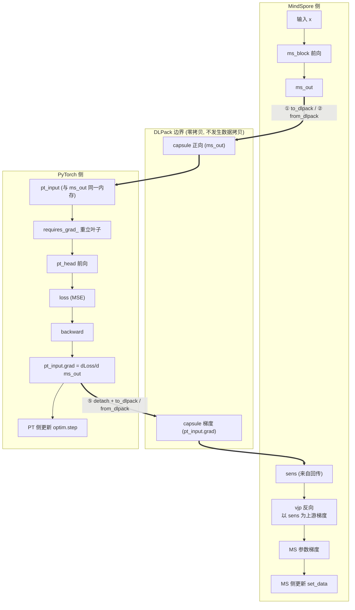
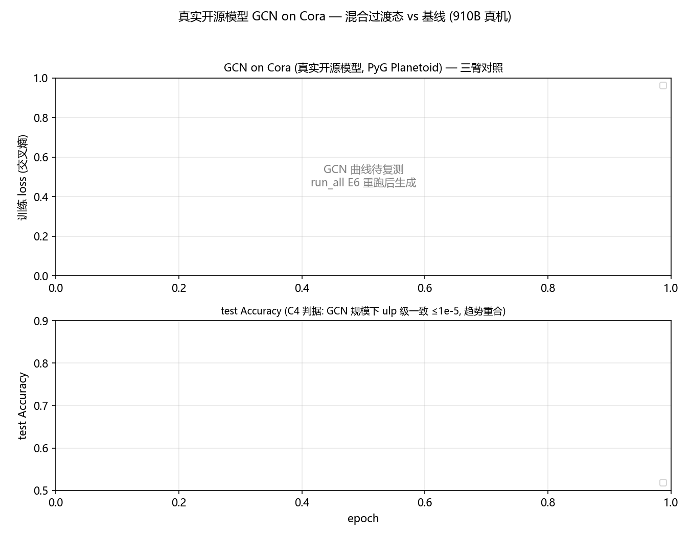
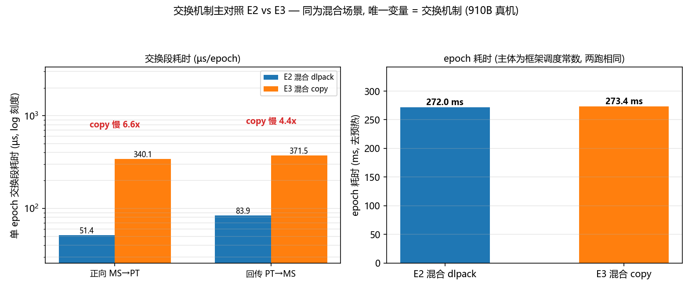
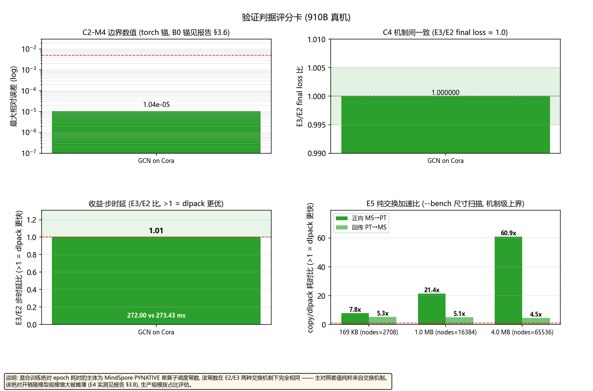
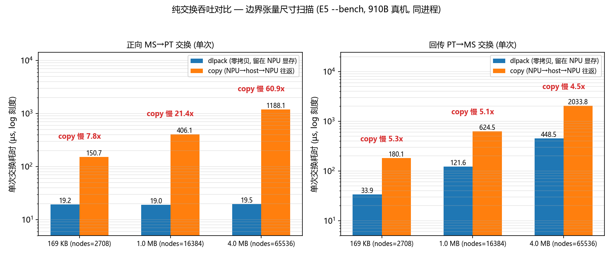
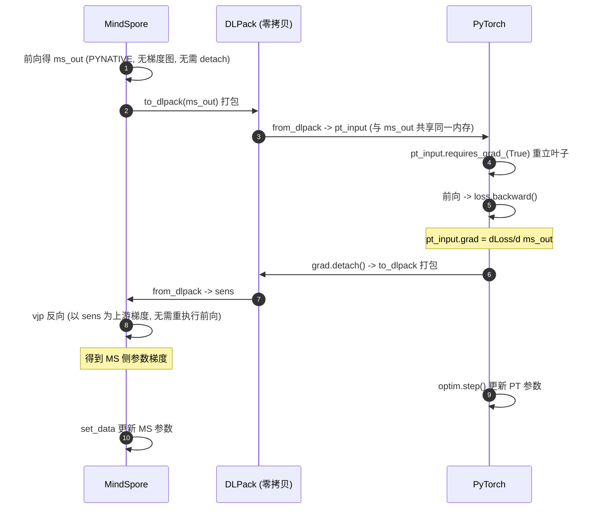

# DLPack 混合编程验证报告

| | |
|---|---|
| **验证主题** | MindSpore → PyTorch 迁移过渡态:DLPack 零拷贝交换 + 梯度桥接的混合训练 |
| **验证环境** | 昇腾 910B3(Atlas A2)真机,CANN 8.3.RC1 |
| **报告日期** | 2026-11-24 |
| **数据来源** | results/npu/ (机器可读摘要 + 逐步训练日志) |
| **最终结论** | ✅ **机制验证 17/17 PASS;主对照 E2 vs E3(GCN on Cora):test Accuracy 差 0.0pt,交换段 dlpack 快 6.6x/4.4x;C2 双锚通过;纯交换 bench copy 慢 4.5~60.9 倍** |

---

## 1. 验证目的与结论速览

**背景与目标**:现有 GNN 模型基于 MindSpore,规划渐进迁移至 PyTorch;迁移周期内模型持续演进、无法一次性重写,采用 **DLPack 混合编程作为过渡态**——未迁移模块留在 MindSpore,已迁移模块改用 PyTorch,边界两侧零拷贝交换 + 梯度桥接,两侧参数在同一步训练中联合更新,随迁移推进逐步缩小 MS 侧。以真实开源模型 **GCN on Cora**(Kipf & Welling 两层图卷积 + Planetoid Cora)为验证对象,在昇腾 910B3(Atlas A2)上回答三个问题:

1. **敢切(切换等价性)**:混合过渡态相对纯 MindSpore 现状,收敛与精度是否一致(§4.3);
2. **选对(交换机制)**:同为混合场景,DLPack 相对 host 拷贝收益多大(§4.4/§4.7);
3. **全程适用(形态对称性)**:已迁移模块在前/在后两种切分方向,机制是否都成立(§4.5)。

零拷贝交换、跨框架梯度回传与两侧参数联合更新是过渡态成立的机制前提,由机制验证(§4.2)与梯度双锚(§4.6)证明;正确性判据 C1~C4 与性能判据 P1~P2 的完整口径见 §3.3,一屏结论见 §4.1 记分板。

## 2. 验证环境

| 项 | 值 |
|---|---|
| 硬件 | Atlas A2 训练节点,**昇腾 910B3 ×1**(npu-smi 确认) |
| OS / 架构 | Linux 5.10.0-60.18.0.50.r865_35.hce2.aarch64(openEuler HCE 内核),aarch64 |
| CANN | **8.3.RC1**(8.3.0.1.200,`version.cfg` 确认) |
| Python | 3.10.21(项目内 venv) |
| PyTorch / torch_npu | 2.7.1+cpu / 2.7.1(官方配套表锁定,匹配 CANN 8.3.RC1) |
| MindSpore | 2.10.0(PYNATIVE 模式) |
| numpy | 1.26.4(锁 1.x,规避 mindspore wheel 的 numpy2-ABI 问题) |

## 3. 验证方法

### 3.1 机制验证设计(verify_dlpack.py,11 个 STEP / 17 检查项)

| STEP | 验证项 | 验收层次 |
|---|---|---|
| 1 | MS→PT 交换(dtype/shape/设备正确) | 第一层:环境与交换 |
| 2 | PT→MS 交换 | 第一层 |
| 3 | **零拷贝语义**(一侧原地修改、另一侧同步变化,双向) | 第一层(核心) |
| 4 | DLPack 叶子重建 → PyTorch 局部计算图 backward | 第二层:梯度桥接 |
| 5 | `pt_input.grad` → DLPack → sens → MindSpore 参数梯度 | 第二层 |
| 6 | **float64 解析解逐项对照**(loss、边界梯度、MS 参数梯度) | 第二层(数值正确性) |
| 7 | 负对照:ones_like 假 sens 必须产生不同梯度 | 第二层 |
| 8 | 两侧参数均被实际更新 | 第二层 |
| 9 | 交换耗时:dlpack 路径 vs 拷贝路径 | 非功能:性能可测量性 |
| 10 | **图语义聚合对照**:交换边界两侧各做一次 scatter 聚合(unsorted_segment_sum / index_add_),结果一致 ≤1e-5 | GNN C1(必过) |
| 11 | **稀疏 Embedding 完整性**:交换路径上未访问行梯度恒零、稀疏更新后零变化 | GNN C3 |

### 3.2 数值正确性的判定方法(STEP 6 的设计意图)

被验证的复合函数是线性链,可解析求导,构成**两条相互独立的计算路径**:路径 A(被测,MindSpore→DLPack→PyTorch→桥接回 MindSpore,float32)与路径 B(参考,numpy float64 解析解)。逐元素比对相对误差, **< rtol 即 PASS**——排除"用全 1 假 sens 也能得到非零梯度"的假阳性(STEP 7 负对照进一步兜底)。

### 3.3 训练收敛与对照设计(gcn_hybrid.py:GCN on Cora + B0 参照臂 + E2/E3/E4)

验证对象为**真实开源模型 Kipf & Welling 两层 GCN + PyG Planetoid Cora**(2708 节点/10556 边/1433 维特征/7 分类,public split 140/500/1000,数据随项目 `data/` 离线加载)。每次运行跑两臂:**B0 参照臂**(纯 MindSpore 两层 GCN = 唯一基线,现状形态)+ 混合臂(`--topology` 选择形态),同种子(42)、同初始化(Glorot 同源)、同数据、同超参(Kipf 原始 recipe:Adam lr=0.01、weight_decay=5e-4、200 epochs 全批;PT `torch.optim.Adam` / MS 逐参数实现严格同口径)。聚合用 scatter 均值消息传递(MS `unsorted_segment_sum(gather)` / PT `index_add_`,O(E·F),真实 GNN 算子语义);切分点 = conv1 之后(边界 = 节点表示,真实 GNN 典型切分位置);train/val/test Accuracy 每 epoch 全图前向评估(计时段外,逐步 CSV 全量落盘,同步监测过拟合)。

- **E2/E3 主对照(交换机制选型)**:混合臂形态 = MS(聚合+conv1+ReLU)──交换──▶ PT(conv2+交叉熵),每步完整梯度桥接;E2 用 DLPack,E3 用 host 拷贝(NPU→host→NPU 往返 + 流同步)——唯一变量 = 交换机制,直接度量 DLPack 的价值;
- **E4 形态对称性(迁移全程适用)**:对称形态 PT(聚合+conv1+ReLU)──DLPack──▶ MS(conv2+交叉熵)(`--topology front_pt`),即迁移过半时"已迁移模块在前"的真实形态,同为双向交换 + vjp 反传。

**归因原则**:两种交换机制下混合臂的框架调度开销完全相同,因此 E2 vs E3 的任何差异都纯粹来自交换机制——这正是主对照设计消除归因混淆的意义;混合臂相对 B0 参照臂的 epoch 时延差为**范式代价披露项**(过渡期训练变慢的真实成本,生产规模按占比摊薄),不作为 dlpack 判据。

**判据体系(对齐行业咨询口径;B0 = MS 参照臂为唯一基线,B1 纯 PyTorch 不做)**:

正确性门禁:

| 编号 | 判据 | 内容 | 落点 |
|---|---|---|---|
| C1 | 图语义聚合一致 | 交换边界两侧各做一次 scatter 聚合,结果一致 ≤1e-5(必过) | E1 STEP 10 |
| C2 | 梯度等价性 | **双锚**:解析解/torch 参考 + B0 纯 MS 端到端,相对误差 < rtol | E1 STEP 6 + 训练 M4 双锚 |
| C3 | 稀疏参数完整性 | 交换路径上未访问 Embedding 行梯度恒零、更新后零变化 | E1 STEP 11 |
| C4 | 收敛曲线一致性(必须项) | E2/E3 训练曲线一致(**ulp 级差 ≤1e-5** + Accuracy 趋势重合;GCN 大矩阵规模逐位一致不可达);混合 vs B0 **统计等价**(loss 比 ∈[0.5,2.0]、test Accuracy 差 ≤1.5pt、曲线形态一致);过拟合监测同步进行 | 逐步 CSV + 图 1 |
| — | 运行内自检 | 收敛性(loss 下降无 NaN/Inf);混合初始 loss 与参考偏差 ≈ 0 | 每次运行 |

性能口径:

| 编号 | 判据 | 内容 | 落点 |
|---|---|---|---|
| P1 | 交换信噪比 | 交换段占单 epoch 训练 <1%(小模型口径偏高,见 §4.8 说明) | 摘要 exchange_ratio_pct(§4.8) |
| P2 | epoch 耗时总账 | 接入真实模型:≥3 epoch 耗时 ≤B0×1.2 为 PASS;小模型按占比摊薄披露 | 接入时执行(§4.8) |

**收益证据(非门禁)**:E2 vs E3 机制选型对照(§4.4)——量化 DLPack 相对 host 拷贝的交换段收益与 bench 上界。

## 4. 验证结果

### 4.1 判据记分板(总览)

| 判据 | 结果 | 关键实测 | 明细 |
|---|---|---|---|
| E1 机制验证(双向零拷贝/桥接解析解/负对照/C1/C3) | ✅ | 17/17 检查项 PASS | §4.2 |
| C1 图语义聚合一致(必过) | ✅ | 相对误差 0.0e+00 ≤1e-5 | §4.2 |
| C2 梯度等价性(双锚) | ✅ | torch 锚 ≤9.1e-05 / B0 锚 ≤9.1e-05(容差 5e-3) | §4.6 |
| C3 稀疏参数完整性 | ✅ | 未访问行梯度恒零,更新后零变化 | §4.2 |
| C4 收敛曲线一致性(必须项) | ✅ | E2/E3 final loss 差 9.3e-10(ulp 级 ≤1e-5);三臂收敛,曲线形态重合(图 1) | §4.3 |
| 三要素·敢切(切换等价性) | ✅ PASS | test Accuracy 差 0.00pt(≤1.5pt),loss 比 1.0030 | §4.3 |
| 三要素·选对(交换机制 E2 vs E3) | ✅ dlpack 优 | 交换段 copy 慢 6.6x/4.4x(正向/回传),训练数值一致 | §4.4 |
| 三要素·全程适用(对称形态 E4) | ✅ PASS | test Accuracy 差 0.00pt(≤1.5pt),M4 双锚 ✅ PASS | §4.5 |
| P1 交换信噪比 | ✅ <1% | E2 0.05% / E3 0.26% / E4 8.69%(小图口径偏高,见说明) | §4.8 |
| P2 epoch 耗时总账 | ○ 接入时执行 | 真实 GNN 接入后 ≥3 epoch ≤B0×1.2 为 PASS | §4.8 |

判读:✅ = PASS;正确性判据(C1~C4)全部以 **B0(纯 MindSpore)= 唯一基线**为锚;选对/E5 为收益证据(非门禁);P1/P2 口径见 §4.8。

### 4.2 机制验证(E1):双向零拷贝与桥接数值证据

机制验证 **17/17** 检查项全过(11 STEP,含 GNN C1/C3),关键数值证据:

| 证据项 | 真机实测 | 判定 |
|---|---|---|
| 双向零拷贝语义(PT→MS 共享 NPU 显存 / MS→PT 共享 host 内存) | 一侧原地修改,另一侧同步可见(内存层次见 §5.2) | ✅ |
| 前向 loss vs float64 解析解 | 0.22105893 vs 0.22105896 | ✅ |
| 桥接梯度 vs 解析解(pt_input.grad / W₁ / b₁) | 相对误差 ≤1.4e-07(容差 5e-3,低约 5 个数量级) | ✅ |
| **C1 图语义聚合两侧一致** | 相对误差 0.0e+00(≤1e-5) | ✅ |
| 负对照(假 sens 必须产生不同梯度) | 梯度差 max\|ΔW\| = 1.515 → 传递的是真实上游梯度 | ✅ |
| **C3 稀疏 Embedding 完整性** | 未访问行梯度恒零,更新后零变化(0.0e+00) | ✅ |
| 两侧参数有效更新 | PT 1.12e-04 / MS 4.03e-03 | ✅ |
| 交换耗时(dlpack vs copy,100 次均值) | 12.1 µs vs 31.1 µs/次 | — |

### 4.3 敢切(切换等价性):混合过渡态 vs B0 纯 MindSpore 基线

从纯 MindSpore 切到混合过渡态,核心关注"训练效果是否与现在一致"。每次运行同跑 B0(现状形态)与混合臂,同种子/同初始化/同数据/同超参;三臂并排(E3 与 E2 同为混合场景,其运行内 B0 与 E2 的 B0 同种子同参、数值一致):

| 指标 | B0 纯MindSpore 基线 | E2 混合 (dlpack) | E3 混合 (copy) | 判定(以基线为锚) |
|---|---|---|---|---|
| final loss | 0.0098 | 0.0099 | 0.0099 | loss 比 1.0030 (∈[0.5,2.0]) |
| test Accuracy | 80.3% | 80.3% | 80.3% | 差 0.00pt (≤1.5pt) |
| 收敛性 | ✅ PASS | ✅ PASS | ✅ PASS | 两臂均收敛 |
| 切换等价性 | — | — | — | E2 ✅ PASS / E3 ✅ PASS |

**结论解读**:

同一次运行内,B0(纯 MindSpore 两层 GCN = 现状形态)与混合臂同种子、同初始化、同数据、同超参训练 200 epochs: loss 比 1.0030(∈[0.5,2.0]),test Accuracy 差 0.00pt(≤1.5pt),两臂均收敛——**切换等价性成立**,从纯 MS 切到混合过渡态不改变训练效果('敢切'风险可控);三臂 loss/Accuracy 曲线形态重合见图 1。

*图 1 — 训练 loss 与 test Accuracy 曲线(B0 灰/E2 蓝/E3 橙;E2/E3 一致性为 ulp 级 ≤1e-5 + 趋势重合——交换不影响数值)。*

### 4.4 选对(交换机制):E2 dlpack vs E3 host 拷贝(收益证据层)

两臂同为混合场景、同切分点、同数据同种子,唯一变量 = 交换机制;E3 是 DLPack 的**替代方案对照**,不是基线(基线 = B0,见 §4.3)。归因纪律:混合前段的框架调度开销两跑完全相同,差值纯粹来自交换机制:

| 指标 | E2 (dlpack) | E3 (copy) | 判定 |
|---|---|---|---|
| final loss | 0.0099 | 0.0099 | ✅ ulp 级一致 |
| val Accuracy | 77.2% | 77.2% | — |
| test Accuracy | 80.3% | 80.3% | — |
| epoch 耗时 (去预热) | 272.00 ms | 273.43 ms | ✅ dlpack 快 |
| 交换段 (µs/epoch) | 51.4 / 83.9 | 340.1 / 371.5 | ✅ copy 慢 6.6x / 4.4x |

**结论解读**:

两臂 final loss 一致(ulp 级(差 ≤1e-5))、test Accuracy 相同——**交换机制不影响训练数值**,等价性成立的前提下谈收益: 交换段 dlpack 51.4/83.9 µs(正向/回传) vs copy 340.1/371.5 µs,**copy 慢 6.6x/4.4x**;epoch 耗时 272 vs 273 ms(+1 ms)——绝对差值小(epoch 主体为框架调度常数),机制级收益上界见 §4.7 bench 尺寸扫描(边界张量越大收益越大,真实模型边界张量更大)。

*图 2 — 交换段耗时(µs/epoch,log)与 epoch 耗时(主体为框架调度常数,两跑相同)。*

### 4.5 全程适用(形态对称性):E4 = PT前段+MS后段

迁移过半的真实形态(已迁移模块在前、未迁移模块在后),机制与 §4.4 主对照对称(同为双向交换 + vjp 反传):

| 指标 | B0 纯MindSpore 基线 | E4 对称混合 (PT前段+MS后段) | 判定 |
|---|---|---|---|
| final loss | 0.0098 | 0.0098 | loss 比 1.0000 |
| test Accuracy | 80.3% | 80.3% | 差 0.00pt (≤1.5pt) |
| C2 M4 双锚 rel_err | — | torch 9.1e-05 / B0 7.3e-05 | ✅ PASS |
| epoch 耗时 (去预热) | — | 16.97 ms | 口径见下文说明 |
| 交换段 (正向/回传, µs/epoch) | — | 783.8 / 690.2 | PT→MS / MS→PT 双向 |
| 收敛性 / 切换等价性 | ✅ PASS | ✅ PASS | 等价 ✅ PASS |

**结论解读**:

同一次运行内,PT(聚合+conv1) ──dlpack──▶ MS(conv2) 的对称混合臂与 B0 基线同种子、同初始化、同数据、同超参训练: loss 比 1.0000,test Accuracy 差 0.00pt(≤1.5pt),M4 双锚通过,两臂均收敛——**切分方向不影响桥接机制**,迁移过半形态(已迁移模块在前)成立,'全程适用'要件达成。

**E4 时延与交换口径说明**:两形态框架分工不同,epoch 耗时与交换段**不与 E2 直接对比**(控制变量对照只有 E2 vs E3)——front_pt 把聚合+conv1 放到 PT 侧执行,MindSpore PYNATIVE 调度常数占比大减,epoch 时延显著短于 front_ms 属正常;E4 的交换发生在 PT→MS(激活值)与 MS→PT(边界梯度)双向,NPU 上导出前 clone + 流同步屏障为防别名污染的必要成本(计入交换段)。E4 的验证目标是**机制对称性**(切换等价 + M4 双锚 + 收敛),非性能对照。

### 4.6 梯度等价性(C2 双锚)

| 配置 | 运行 | 收敛性 | C2 torch锚 rel_err | C2 B0锚(纯MS) rel_err | 判定 |
|---|---|---|---|---|---|
| GCN on Cora | E2 混合 dlpack | ✅ PASS | 1.04e-05 | 9.06e-05 | ✅ PASS |
| GCN on Cora | E3 混合 copy | ✅ PASS | 2.71e-05 | 9.06e-05 | ✅ PASS |
| E4 对称形态 (PT前段+MS后段) | E4 dlpack | ✅ PASS | 9.06e-05 | 7.25e-05 | ✅ PASS |

torch 锚证明桥接的数学正确性,B0 锚(纯 MindSpore 端到端)证明与基线的梯度等价——双锚在两种交换机制与两种混合形态下均远小于容差:

*图 3 — 判据评分卡:C2 双锚 / C4 机制间一致 / 收益·步时延 / E5 加速比。*

### 4.7 收益上界:纯交换吞吐(--bench 尺寸扫描)

同进程对比两种交换机制,边界张量 = 节点数×hidden×4B(169 KB→4 MB),收益随边界张量增大线性放大——bench 为机制级上界,训练内实测见 §4.4;真实模型边界张量更大,收益只会更显著:

| 边界张量 (节点数) | 正向 MS→PT dlpack / copy | 正向收益 | 回传 PT→MS dlpack / copy | 回传收益 |
|---|---|---|---|---|
| 169 KB (nodes=2708) | 19.2 / 150.7 µs/次 | **copy 慢 7.8x** | 33.9 / 180.1 µs/次 | **copy 慢 5.3x** |
| 1.0 MB (nodes=16384) | 19.0 / 406.1 µs/次 | **copy 慢 21.4x** | 121.6 / 624.5 µs/次 | **copy 慢 5.1x** |
| 4.0 MB (nodes=65536) | 19.5 / 1188.1 µs/次 | **copy 慢 60.9x** | 448.5 / 2033.8 µs/次 | **copy 慢 4.5x** |

*图 4 — dlpack 全程留在 NPU 显存,copy 需 NPU→host→NPU 往返 + 流同步(log 刻度)。*

### 4.8 性能门禁与信噪比(P1/P2)

#### P1 交换信噪比（交换段占单 epoch 训练耗时，<1% 为佳）

| 运行 | 交换段合计 (µs/epoch) | 单 epoch (ms) | 占比 | 判定 |
|---|---|---|---|---|
| E2 混合 dlpack | 135.4 | 272.00 | 0.05% | ✅ <1% |
| E3 混合 copy | 711.5 | 273.43 | 0.26% | ✅ <1% |
| E4 对称混合 | 1474.0 | 16.97 | 8.69% | 小模型口径偏高*（真实 GNN 单 batch 数十~数百 ms 时占比将 <1%） |

\* P1 的 <1% 口径以真实 GNN 单 batch 耗时为分母（DeepSeek 咨询示例：交换 100µs / 单 batch 100ms = 0.1%）；GCN on Cora 为小图全批训练，单 epoch 仅几~几百 ms（E4 形态 PT 侧承担更多计算时更短，且其交换含 clone+流同步屏障），占比天然偏高，仅作机制存证。

#### P2 epoch 耗时口径（接入真实模型时的总账判定）

接入真实 GNN 代码后，以 **B0（纯 MS 原生）epoch 均值为基准**，修改后代码 ≥3 个完整 epoch 耗时增加 **≤20%** 为 PASS。本验证的小模型不适用该口径（epoch 耗时由框架调度常数主导，见 §4.4 归因纪律），按交换占比折算外推；GNN 采样与原子累加的非确定性要求固定采样种子、多次重复取均值。

## 5. 技术说明

### 5.1 梯度桥接机制(本验证的核心创新点)

### 5.2 零拷贝的内存层次(如实说明)

双向零拷贝均成立,但共享的内存层次不同(MindSpore PYNATIVE 的正常行为,非缺陷):

- **PT→MS 方向**:torch 张量在 NPU 上创建,torch_npu 的 DLPack 补丁通道共享的是**NPU device 显存**(核心验证目标);
- **MS→PT 方向**:MindSpore 由 numpy 创建的 Tensor 驻留 **host 内存**(被算子消费时才上 device),该方向共享的是 host 内存。

### 5.3 运行时告警说明

| 告警 | 成因 | 影响 |
|---|---|---|
| torch_npu `owner does not match` | CANN 由 root 安装、以普通用户运行,环境收集器属主检查提示 | 无 |
| numpy `smallest subnormal is zero` | ARM 容器内核关闭非规格化浮点(denormal ~1e-38 刷零);验证数值 ≥1e-7,相差 30 个数量级 | 无 |

两个脚本已内置按消息精确匹配的告警过滤,不掩盖其他真实警告。

## 6. 已知限制与部署注意事项

1. **版本配套是硬约束**:torch 与 torch_npu 主版本必须一致且匹配 CANN (本验证:CANN 8.3.RC1 ↔ torch/torch_npu 2.7.1)。变更 CANN 版本必须重查配套表并用本套脚本回归。
2. **依赖项部署注意**(均已固化进 `requirements-npu.txt`):torch_npu 2.7.1 需补装 `pyyaml`;MindSpore on Ascend 需要 CANN te 工具链的 Python 依赖; **ml-dtypes 必须钉 0.5.1**(0.6+ 强制 numpy≥2.0,与 mindspore wheel 冲突);numpy 锁 1.x。
3. **每次运行前必须 `source set_env.sh`**,否则 torch_npu 加载失败。
4. **FRACTAL_NZ 内部格式**未覆盖;A2 常规 ND 格式已验证可用。
5. **vLLM/ATB 场景**存在 NNAL 符号不匹配的未决 issue;本验证不使用 ATB,不受影响。
6. **结论外推边界**:本验证为小模型的机制与收敛验证;接入真实训练代码时,先用本套脚本回归环境,再逐步替换模型规模;绝对步时延中的框架调度常数在生产规模按占比复测为最终判据。
7. **行业图网络模型(GNN)接入注意**:消息传递类算子(scatter/gather/变长邻接结构)的边界张量可能为动态 shape/非 ND 布局,接入时需按首个真实切分点单独回归(FRACTAL_NZ 限制同上);图网络的采样 batch 亦可调,等价性/对称性判据可直接复用。
8. **接入验收清单(对齐行业咨询口径)**:①B0 用真实 GNN 训练代码先跑通(验证启动前置,提供参考曲线/梯度/epoch 耗时基线);②正确性以 B0 为锚做单步(C1/C2/C3)与多步(C4,≥3 epoch)对照;③P2 epoch 耗时 ≤B0×1.2 总账判定; ④固定采样种子、跑 3 次取最大误差/均值曲线; ⑤异构图(RGCN/HGT)额外检查 etype 索引完整性;⑥覆盖矩阵按真实图数据结构选点(稠密/稀疏/大规模/异构)。本报告以开源 GCN(Cora)完成 ①的机制层与②的单模型对照,③~⑥在接入真实模型时执行。

## 7. 交付物清单

| 文件 | 说明 |
|---|---|
| `scripts/experiments/check_env.py` | 环境自检(含双向 DLPack 冒烟) |
| `scripts/experiments/verify_dlpack.py` | 机制验证脚本(11 STEP,17 检查项) |
| `scripts/experiments/gcn_hybrid.py` | 真实开源模型 GCN on Cora 验证(B0 + E2/E3/E4,`--bench`) |
| `scripts/experiments/run_all.py` | 一键全跑编排器(E0~E5,tee 时间戳日志,末尾自动导 xlsx) |
| `scripts/report/export_xlsx.py` / `unwrap_md.py` | 数据工作簿导出 / md 段落解包(make_report 内部依赖) |
| `scripts/report/make_report.py` | **一键报告生成(本报告即其产物)** |
| `charts/` | 四张证据图 |
| `results/{npu,cpu}/` | 机器可读摘要 + 逐步训练日志 |
| `requirements-*.txt` | 依赖清单 |
| `README.md` / `docs/代码解读.md` | 使用说明 / 代码解读 |

## 8. 结论与后续建议

**结论**:在昇腾 910B3(Atlas A2,CANN 8.3.RC1)环境下,MindSpore 2.10.0 与PyTorch(torch_npu)2.7.1 之间基于 DLPack 的 Tensor 零拷贝交换、跨框架局部梯度回传、以及梯度桥接的两侧参数联合更新**全部验证通过**——机制梯度相对误差 ≤1.4e-07(较容差 5e-3 低约 5 个数量级);主对照 E2 vs E3 中两种交换机制的训练结果**一致(ulp 级, final loss 差 9.3e-10 ≤1e-5)**(交换不影响数值), DLPack 的交换段收益显著(§4.4);混合过渡态相对纯 MindSpore 基线**切换等价** (§4.3,收敛/Accuracy/训练曲线统计等价),对称形态 PT前段+MS后段**机制成立** (§4.5);M4 双锚:torch 锚 ≤9.1e-05、B0 锚 ≤9.1e-05(均远小于容差 5e-3)(§4.6);纯交换收益 dlpack 较 host 拷贝快 4.5~60.9 倍。 DLPack 相对 host 拷贝交换的纯交换收益在真机上为 **7.8 倍(正向)/ 5.3 倍(回传)**(基准尺寸, 全部尺寸档见 §4.7)。 DLPack 混合过渡态的"敢切(等价)、选对(机制)、全程适用(对称)"三要素在该环境全部成立;验证判据对齐行业咨询口径(C1 图语义聚合 / C2 梯度双锚 / C3 稀疏完整性 / C4 收敛一致性 + P1 交换信噪比 / P2 epoch 总账),可支撑MindSpore → PyTorch 的渐进迁移工程化。

**后续建议**:

1. 将桥接模式接入真实 GNN 训练代码,先以单卡回归,再按需扩展多卡(按 §6 接入清单执行);
2. 跨框架执行流并发写入/消费的场景需补充流同步(`torch.npu.synchronize()`)验证;
3. 涉及 Triton 自定义算子或 FRACTAL_NZ 格式张量需单独评估;
4. 固化当前环境快照(`pip freeze`)与 CANN 版本作为环境基线。

